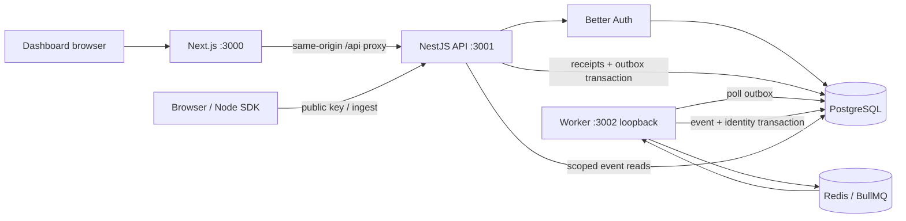

# Architecture

The dashboard proxies `/api/*` to the API so management sessions remain
same-origin. NestJS owns authentication and authorization. SDK ingestion is a
separate credential-free CORS path authenticated by a public project write key.

PostgreSQL is the durable source of receipts, pending outbox work, events, and
identity links. HTTP 202 follows the receipt/outbox commit. Redis transports
receipt IDs to workers; it is outside the acknowledgement transaction. Redis
loss or worker downtime delays visibility while pending receipts remain durable.

## Boundaries

- `apps/api`: HTTP, sessions, workspace access, ingestion, event reads, analytics,
  conversion path evaluation, and replay.
- `apps/web`: dashboard forms, event explorer, analytics, conversion paths,
  and processing status.
- `apps/worker`: outbox dispatch, BullMQ consumer, retention, private health.
- `packages/contracts`: shared bounded validation and response types.
- `packages/database`: schema, migrations, and database client factory.
- `packages/pipeline`: queue configuration, processing, retry state, cleanup.
- `packages/sdk`: explicit browser/Node event collection.
- `examples/demo`: synthetic gameplay and identity controls.

Services check workspace membership before reading tenant data. A project ID is
resolved within its workspace. Owners/admins can replay retained failures;
viewers can read events and aggregate processing status. Public keys never
authenticate management requests.

## Event lifecycle

1. Ingestion validates the whole batch and resolves the active project key.
2. One transaction inserts unseen project/event IDs and their outbox rows.
3. The dispatcher publishes receipt ID/generation jobs and periodically revisits
   pending outbox rows.
4. Processing locks a receipt, checks status/generation, writes the analytics
   event and identity association, clears its receipt payload, and removes outbox
   work in one transaction.
5. Failed jobs retry with bounded exponential backoff. Exhausted receipts retain
   failure state; an owner/admin can create a fresh replay generation.
6. Cleanup removes old analytics events and expires failed payloads. Receipt
   tombstones remain for duplicate protection.

See [event semantics and operations](events.md) and
[the delivery decision](decisions/0002-event-delivery.md) for exact bounds,
identity rules, recovery, and limitations.

## Later work

Analytics, conversion paths, and daily retention query stored events directly.
Retention uses one PostgreSQL statement for a consistent snapshot of entries,
canonical identities, and distinct return days. Partitioning, rollups, distributed admission
limits, and complete production container packaging require separate scope and
measurements.
