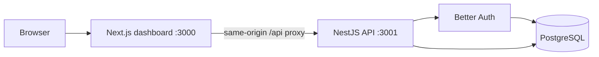

# Architecture

The dashboard proxies `/api/*` to the API so browser sessions remain same-origin.
NestJS owns authentication and authorization. PostgreSQL owns application state.
Redis and the separate worker process enter with the event pipeline in Phase 2.

## Boundaries

- `apps/api`: HTTP transport, authentication, workspace and project services.
- `apps/web`: dashboard routes, forms, and accessible UI components.
- `packages/contracts`: validated requests and shared response types.
- `packages/database`: Prisma schema, migrations, and database client factory.

Application services check workspace membership before reading or changing tenant
data. A project ID is always resolved within its workspace. Public project keys
are write credentials reserved for future ingestion; management requires a session.

## Delivery sequence

Phase 1 establishes accounts and tenant boundaries. Phase 2 adds event records,
transactional outbox dispatch, SDK delivery, and workers. Analytics initially query
stored events directly. Aggregation is added only when measurements justify it.
